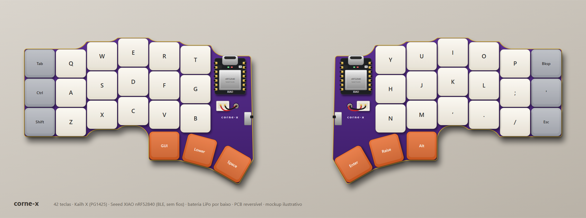
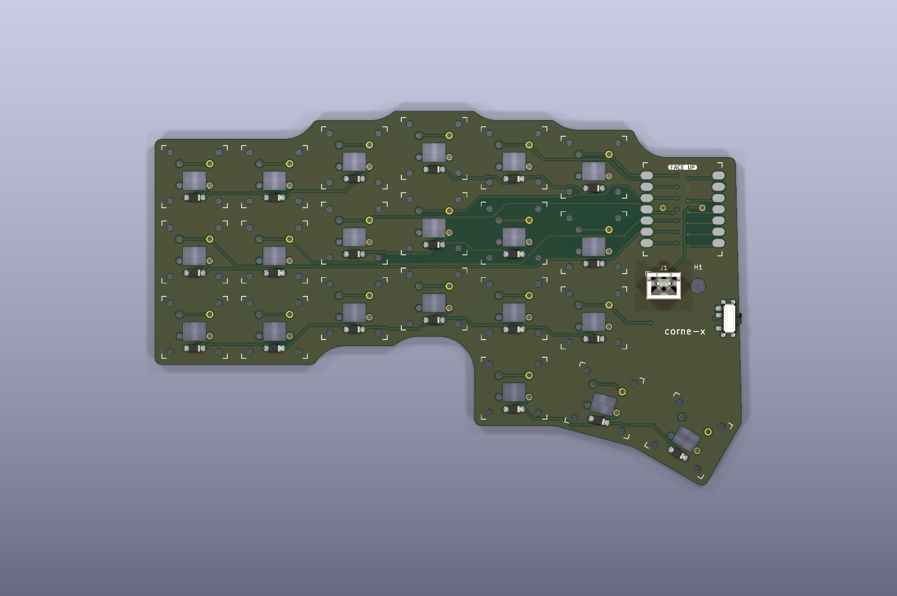
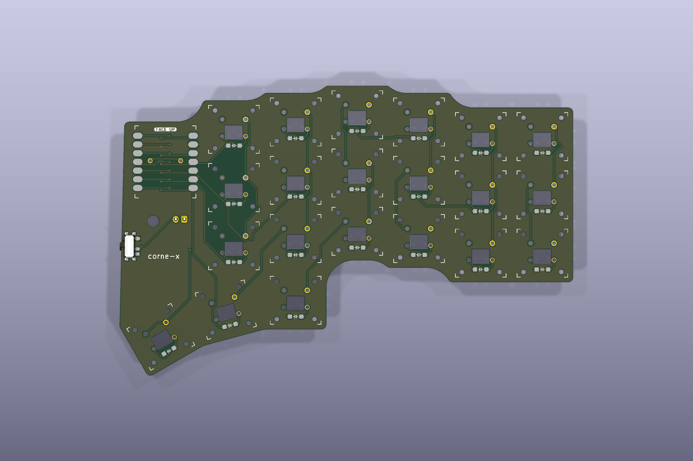

# corne-x

PCB reversível e sem fios no formato **Corne** (3×6 + 3 polegares por metade, 42 teclas),
com os mesmos componentes do [dust](https://github.com/hazels-garage/dust): switches Kailh X
(PG1425), díodos 1N4148 SOD-123, Seeed XIAO nRF52840 (BLE), interruptor de energia e
bateria LiPo com conector JST-XH.



| Frente | Verso |
| :---: | :---: |
|  |  |

## Estado
- Roteada nas duas camadas, com plano de GND.
- **DRC do KiCad 10: 0 violações e 0 ligações em falta** (ver as exceções abaixo).
- Gerbers e furação prontos em [`corne-x-gerbers.zip`](corne-x-gerbers.zip).

## Ficheiros
| Ficheiro | O que é |
|---|---|
| `corne-x.kicad_pcb` / `.kicad_pro` / `.kicad_dru` | Projeto KiCad 10 (placa, regras e exceções do DRC) |
| `corne-x-gerbers.zip` | Gerbers + furação (Excellon) para encomendar |
| `gerar_pcb.py` | 1.ª fase: layout, matriz e contorno (`python gerar_pcb.py <dust.kicad_pcb>`, precisa de `shapely`) |
| `finalizar_pcb.py` | 2.ª fase, com o Python do KiCad: JST-XH, furo, Freerouting, GND, DRC e gerbers |
| `mockup.py` / `mockup.svg` / `mockup.png` | Render ilustrativo das duas metades montadas |
| `preview.svg` | Vista técnica da matriz (colunas e linhas) |

Para regenerar tudo:

```
python gerar_pcb.py caminho/para/dust/pcbs/dust.kicad_pcb
"%LOCALAPPDATA%\Programs\KiCad\10.0\bin\python.exe" finalizar_pcb.py caminho/para/freerouting-2.5.0.jar
python mockup.py
```

O Freerouting 2.5 precisa do Java 25 ou mais recente.

## Bateria
- **J1**: JST-XH 2,50 mm vertical, de furos passantes, que serve nas duas faces. O pino 1 é o BAT+ e o pino 2 o BAT−.
- **H1**: furo de 3,2 mm ao lado do conector, para passar os fios da bateria, que fica por baixo da placa.
- **PWR1**: interruptor no BAT− (entre o BAT− e o GND), tal como no dust.
- O BAT+ vai para o pad de bateria do XIAO pelos furos do footprint.
- Atenção à altura: o JST-XH vertical tem cerca de 7 mm, bem mais do que os switches Kailh X.

## Matriz e pinos do XIAO
| Pino | Função | Pino | Função |
|---|---|---|---|
| D0 | c5 (indicador interno) | D7 | r0 (polegares) |
| D1 | c4 (indicador) | D8 | r1 (fila de baixo) |
| D2 | c3 (médio) | D9 | r2 (fila home) |
| D3 | c2 (anelar) | D10 | r3 (fila de cima) |
| D4 | c1 (mindinho) | D6 | livre |
| D5 | c0 (mindinho externo) | | |

- Os díodos têm o cátodo (pad 1) na linha, por isso o sentido é COL2ROW (no ZMK, `diode-direction = "col2row"`).
- Os polegares usam as colunas c3, c4 e c5 da linha r0.
- A metade direita é a mesma PCB virada: basta encomendar um único desenho.

## Exceções do DRC
Os footprints do Kailh X, do díodo e do XIAO vêm do dust, que foi fabricado e montado com eles. A geometria interna destes footprints não cumpre algumas regras genéricas, por isso há três exceções:

- **`corne-x.kicad_dru`**: permite 0,1 mm entre furos e pads *dentro* do mesmo footprint de switch ou díodo. Pistas e zonas continuam sujeitas às regras normais.
- **`pth_inside_courtyard`** (ignorada): o díodo passante fica de propósito entre os pinos do switch.
- **`lib_footprint_issues`** (ignorada): a biblioteca de footprints do autor não está instalada.

Regras de roteamento usadas: 0,2 mm de distância, pistas de 0,25 mm (algumas estreitam para 0,187 mm junto aos pads), vias de 0,6/0,3 mm e 0,2 mm até à borda. Tudo isto está dentro das capacidades normais da JLCPCB.

## Créditos
- Footprints e eletrónica: dust, de Jason Hazel (CC BY 4.0).
- Layout: Corne (crkbd), de foostan (MIT).
- Este projeto: CC BY 4.0.
